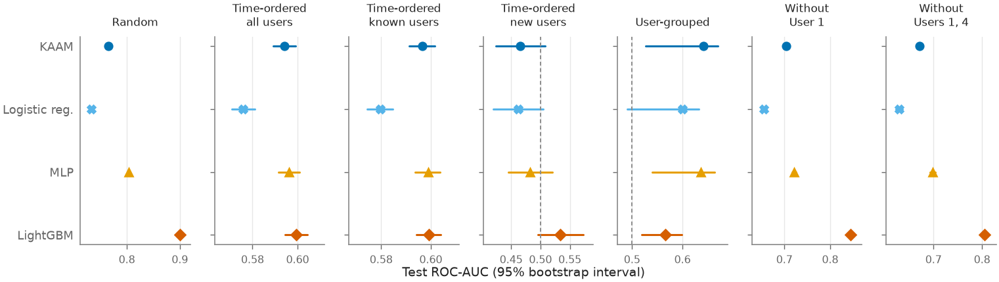

# KANVAS

*KANVAS: Auditing Shortcut Learning in GPU Job Failure Prediction with Additive Kolmogorov-Arnold Models*

KANVAS predicts whether a job on a shared GPU cluster will fail and explains each prediction as one readable curve per input. Tested on Alibaba's public 2020 GPU trace, it shows that random splits reward models for memorising a few heavy users, and that performance drops sharply for new users.

- Live demo: https://kanvas.streamlit.app (serves the first-version model; code in `app/`)
- Code: https://github.com/Swapnil007-Curious/KANVAS
- Paper: coming soon
- Kaggle notebooks: coming soon
- Author: Swapnil Shukla, Independent Researcher, India

Test ROC-AUC with 95% bootstrap intervals on the full trace (539,816 tasks). Each panel has its own scale, and the
dashed line marks chance (0.5).

## Results (test ROC-AUC, full trace)

| Model | Random | Time, known users | Time, new users | User-grouped |
|---|---:|---:|---:|---:|
| KAAM | 0.766 | 0.596 | 0.466 | 0.641 |
| Logistic regression | 0.732 | 0.580 | 0.462 | 0.600 |
| MLP | 0.804 | 0.599 | 0.482 | 0.637 |
| LightGBM | 0.900 | 0.599 | 0.534 | 0.566 |

LightGBM leads on random splits, but with whole users held out it scores lowest of the four, and on the new users
of the time-ordered split every model is near or below chance. The numbers come from
`results/analysis/full/model_ci.csv`; `python scripts/readme_assets.py` prints this table and the full ones below
and redraws the figure.

## Limitation (read this first)

**Do not use the model for new users.** The features predict failures best for users whose earlier tasks are in
the training data. For users a model has never seen, every model in the study, readable or not, does far worse
(user-grouped ROC-AUC 0.57 to 0.64 on the full trace, close to chance on some folds), and accuracy also drops on a
later period of the trace. The random-split scores above describe neither case. One user submits 31% of the tasks and 55% of the
failures. See Section 6 of the paper.

## About this version

This repository holds the second version of the study: the whole labelled Alibaba PAI 2020 trace instead of a
sample, ten leak-free features, four evaluation protocols (random, time-ordered, user-grouped and
leave-dominant-user-out), five baselines (logistic regression, a parameter-matched MLP, LightGBM and two
Explainable Boosting Machines), paired-bootstrap statistics with Holm correction, and a full and an IEEE
conference version of the paper (sources in `paper/`).

## Full results (test ROC-AUC)

Full trace, 539,816 tasks (the EBMs take hours per fit at this size and were fitted on the original sample only):

| Model | Random | Time, all | Time, known users | Time, new users | User-grouped | Without User 1 | Without Users 1, 4 |
|---|---:|---:|---:|---:|---:|---:|---:|
| KAAM | 0.766 | 0.594 | 0.596 | 0.466 | 0.641 | 0.703 | 0.672 |
| Logistic regression | 0.732 | 0.576 | 0.580 | 0.462 | 0.600 | 0.656 | 0.630 |
| MLP | 0.804 | 0.596 | 0.599 | 0.482 | 0.637 | 0.721 | 0.698 |
| LightGBM | 0.900 | 0.599 | 0.599 | 0.534 | 0.566 | 0.845 | 0.805 |

Original sample, the 18,890 tasks of the first version:

| Model | Random | Time, all | Time, known users | Time, new users | User-grouped | Without User 1 | Without Users 1, 4 |
|---|---:|---:|---:|---:|---:|---:|---:|
| KAAM | 0.744 | 0.595 | 0.603 | 0.515 | 0.620 | 0.698 | 0.627 |
| Logistic regression | 0.723 | 0.588 | 0.589 | 0.565 | 0.561 | 0.662 | 0.602 |
| MLP | 0.722 | 0.523 | 0.533 | 0.548 | 0.540 | 0.681 | 0.531 |
| LightGBM | 0.810 | 0.619 | 0.620 | 0.552 | 0.502 | 0.756 | 0.673 |
| EBM, additive | 0.756 | 0.595 | 0.596 | 0.533 | 0.489 | 0.722 | 0.646 |
| EBM, pairwise | 0.803 | 0.573 | 0.565 | 0.539 | 0.504 | 0.752 | 0.685 |

Generated from `results/analysis/*/model_ci.csv` by `scripts/readme_assets.py`; 95% intervals, paired
comparisons with Holm correction, PR-AUC, Brier score and calibration are in the paper and in
`data/processed/publication/`.

- On random splits the models with interactions lead (LightGBM +0.134 AUC over KAAM on the full trace).
- In each random split of the full trace about 29% of the test tasks have an exact copy of all ten features in training.
- With users held out that lead disappears and no model is clearly best (0.553 to 0.624 on the four user-grouped folds without the dominant user).
- On the last 15% of the trace by start time every model scores about 0.58 to 0.60, even on known users.
- KAAM's curves and exact per-task contributions trace the random-split signal to a one-core rule learned from one
  user, which disappears when that user is removed.

## What KAAM is

KAAM (Kolmogorov-Arnold Additive Model) gives each of the 10 input features its own learnable B-spline edge and
sums the results:

    risk = sigmoid( sum_i phi_i(x_i) + bias ),   phi_i(x) = w_i * SiLU(x) + sum_j c_ij * B_j(x)

Features never interact, so every prediction splits exactly into 10 contributions, and each phi_i can be plotted
as a curve. The model has 151 parameters. Feature decoupling is enforced structurally with a PyTorch `ModuleDict`
and checked by a unit test.

## Repository layout

    kanvas/            model, data pipeline, full-trace build, per-split preprocessing, protocols, models, metrics
    scripts/           build_full_trace.py, run_experiments.py, analyze.py, interpret_v2.py, lookback_v2.py,
                       export_publication.py, paper_tables.py, paper_figures.py, paper_claims.py, build_paper.py,
                       readme_assets.py
    paper/             PROTOCOL.md (written before any test access), main.tex, ieee/main_ieee.tex, sections/,
                       tables/ and figures/ (generated), CLAIMS.md (audit), REVIEW.md (independent review)
    results/           data facts, attrition, run outputs, analyses, test-access log
    data/processed/publication/   identifier-free exports and data dictionary (v1 files in v1/)
    figures/readme/    the figure at the top of this README (generated)
    notebooks/         the first version's notebooks 01 to 07
    app/               Streamlit demo (first-version model)
    tests/             pytest suite

## Reproduce

    pip install -r requirements.txt
    pytest -m "not slow"

The raw trace is not included (about 1.4 GB). Download `cluster-trace-gpu-v2020` from
https://github.com/alibaba/clusterdata and extract the five tables used here into `data/raw/`. Then:

    python scripts/build_full_trace.py          # full-trace datasets at five lookback windows
    python scripts/data_facts.py
    python scripts/run_experiments.py --dataset original
    python scripts/run_experiments.py --dataset full --protocols random,time,grouped,louo --queue   # one or more workers
    python scripts/analyze.py --dataset full
    python scripts/analyze.py --dataset original
    python scripts/interpret_v2.py
    python scripts/lookback_v2.py
    python scripts/export_publication.py
    python scripts/paper_tables.py && python scripts/paper_figures.py && python scripts/paper_claims.py
    python scripts/build_paper.py
    python scripts/readme_assets.py             # README figure and tables

The evaluation protocol was written before any model was trained on the new data, and test labels are read only
through `kanvas/testaccess.py`, which logs every access in `results/test_access_log.jsonl`. Four deviations, all
made before the first test access, are listed in `paper/PROTOCOL.md`.

## Data

Derived from the Alibaba cluster-trace-gpu-v2020 dataset (CC BY 4.0; Weng et al., "MLaaS in the Wild: Workload
Analysis and Scheduling in Large-Scale Heterogeneous GPU Clusters", NSDI 2022). User and job identifiers are
removed from every exported file, and a test enforces it.

## Related projects

- VeriDex is a free assistant that searches a fixed library of open textbooks and Indian statutes before answering, cites its passages for every sentence and labels answers from outside the library ([live demo](https://swapnil007-curious.github.io/VeriDex/), [code](https://github.com/Swapnil007-Curious/VeriDex)).
- ManuVox recognises 250 isolated American Sign Language signs from a webcam and speaks the result as a short English sentence, running entirely in the browser so video never leaves the device ([live demo](https://swapnil007-curious.github.io/ManuVox/), [code](https://github.com/Swapnil007-Curious/ManuVox)).

## License

MIT. See `LICENSE`.
